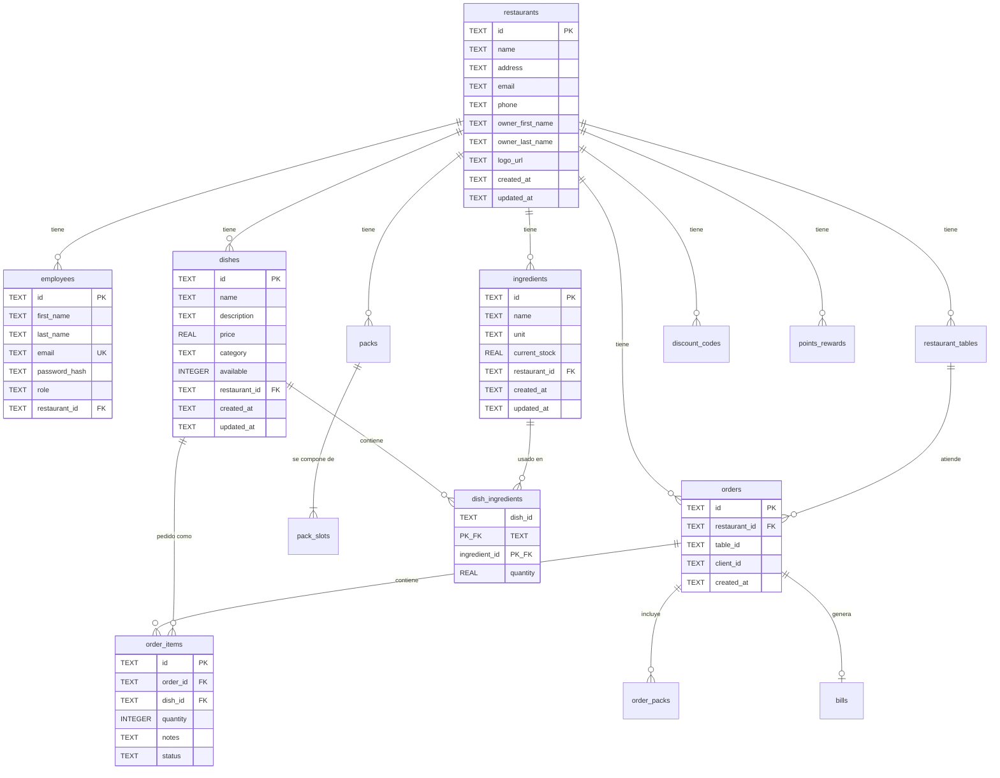

# Modelo de Datos

Esquema de la base de datos SQLite de Resttek.

---

## Diagrama Entidad-Relación

---

## Tablas

### `restaurants`

Almacena la información de los restaurantes.

| Columna | Tipo | Nullable | Descripción |
| --- | --- | --- | --- |
| `id` | TEXT | No | UUID, clave primaria |
| `name` | TEXT | No | Nombre del restaurante |
| `address` | TEXT | No | Dirección |
| `email` | TEXT | No | Email de contacto |
| `phone` | TEXT | No | Teléfono |
| `owner_first_name` | TEXT | No | Nombre del propietario |
| `owner_last_name` | TEXT | No | Apellido del propietario |
| `logo_url` | TEXT | Sí | URL del logo |
| `created_at` | TEXT | No | Fecha de creación (ISO 8601) |
| `updated_at` | TEXT | No | Fecha de última actualización |

---

### `employees`

Almacena **todos** los usuarios del sistema, incluidos los clientes: no hay tabla de clientes aparte. Un cliente es una fila con `role = 'cliente'` y `restaurant_id` a null.

| Columna | Tipo | Nullable | Descripción |
| --- | --- | --- | --- |
| `id` | TEXT | No | UUID, clave primaria |
| `first_name` | TEXT | No | Nombre |
| `last_name` | TEXT | No | Apellido |
| `email` | TEXT | No | Email (único) |
| `password_hash` | TEXT | No | Hash bcrypt de la contraseña |
| `role` | TEXT | No | Rol: admin, manager, camarero, cocinero, cliente |
| `restaurant_id` | TEXT | Sí | FK → `restaurants.id` (null para admin y cliente) |

**Restricciones:**

- `email` es UNIQUE.
- `restaurant_id` es FK a `restaurants.id`.

---

### `ingredients`

Ingredientes disponibles en cada restaurante.

| Columna | Tipo | Nullable | Descripción |
| --- | --- | --- | --- |
| `id` | TEXT | No | UUID, clave primaria |
| `name` | TEXT | No | Nombre del ingrediente |
| `unit` | TEXT | No | Unidad: kg, g, l, ml, unidad |
| `current_stock` | REAL | No | Stock actual (default: 0) |
| `restaurant_id` | TEXT | No | FK → `restaurants.id` |
| `created_at` | TEXT | No | Fecha de creación |
| `updated_at` | TEXT | No | Fecha de última actualización |

---

### `dishes`

Platos de la carta de cada restaurante.

| Columna | Tipo | Nullable | Descripción |
| --- | --- | --- | --- |
| `id` | TEXT | No | UUID, clave primaria |
| `name` | TEXT | No | Nombre del plato |
| `description` | TEXT | Sí | Descripción |
| `price` | REAL | No | Precio en euros |
| `category` | TEXT | No | Categoría: entrante, principal, postre, bebida |
| `available` | INTEGER | No | Disponibilidad: 1 = sí, 0 = no (default: 1) |
| `restaurant_id` | TEXT | No | FK → `restaurants.id` |
| `created_at` | TEXT | No | Fecha de creación |
| `updated_at` | TEXT | No | Fecha de última actualización |

---

### `dish_ingredients`

Relación muchos-a-muchos entre platos e ingredientes.

| Columna | Tipo | Nullable | Descripción |
| --- | --- | --- | --- |
| `dish_id` | TEXT | No | FK → `dishes.id` (PK compuesta) |
| `ingredient_id` | TEXT | No | FK → `ingredients.id` (PK compuesta) |
| `quantity` | REAL | No | Cantidad del ingrediente necesaria |

**Restricciones:**

- PK compuesta: (`dish_id`, `ingredient_id`).
- FK a `dishes.id` **con** `ON DELETE CASCADE`: al borrar un plato desaparecen sus ingredientes asociados.
- FK a `ingredients.id` **sin** cascada.

---

### `orders`

Pedidos de los clientes.

| Columna | Tipo | Nullable | Descripción |
| --- | --- | --- | --- |
| `id` | TEXT | No | UUID, clave primaria |
| `restaurant_id` | TEXT | No | FK → `restaurants.id` |
| `table_id` | TEXT | Sí | Identificador de mesa (opcional) |
| `client_id` | TEXT | Sí | ID del cliente (opcional) |
| `created_at` | TEXT | No | Fecha de creación |

---

### `order_items`

Líneas de pedido. Cada ítem es un plato con cantidad y estado.

| Columna | Tipo | Nullable | Descripción |
| --- | --- | --- | --- |
| `id` | TEXT | No | UUID, clave primaria |
| `order_id` | TEXT | No | FK → `orders.id` |
| `dish_id` | TEXT | No | FK → `dishes.id` |
| `quantity` | INTEGER | No | Cantidad pedida |
| `notes` | TEXT | Sí | Notas del cliente (ej: "sin gluten") |
| `status` | TEXT | No | Estado: pendiente, preparando, listo, entregado |

**Restricciones:**

- ON DELETE CASCADE desde `orders.id`.

---

## restaurant_tables

Mesas de un restaurante.

| Columna | Tipo | Nulo | Descripción |
| --- | --- | --- | --- |
| `id` | TEXT | No | PK (UUID) |
| `restaurant_id` | TEXT | No | FK a `restaurants.id` (ON DELETE CASCADE) |
| `number` | INTEGER | No | Número de mesa. `UNIQUE(restaurant_id, number)` |
| `description` | TEXT | Sí | Ubicación o descripción (terraza, ventana...) |
| `capacity` | INTEGER | No | Comensales que caben |
| `status` | TEXT | No | Estado: libre, ocupada, reservada |
| `created_at` | TEXT | No | Fecha ISO 8601 |
| `updated_at` | TEXT | No | Fecha ISO 8601 |

`orders.table_id` guarda el `id` de la mesa del pedido (sin clave foránea, ya que un pedido puede no tener mesa). El número de mesa se obtiene con un `LEFT JOIN` al leer los pedidos.

---

## points_rules

Regla de puntos de un restaurante: por cada `euros_per_block` € gastados el cliente gana `points_per_block` puntos. Si un restaurante no tiene fila se aplica la regla por defecto (1 punto por cada 10 €).

| Columna | Tipo | Nulo | Descripción |
| --- | --- | --- | --- |
| `restaurant_id` | TEXT | No | PK, FK a `restaurants.id` |
| `euros_per_block` | REAL | No | Euros por bloque (X) |
| `points_per_block` | INTEGER | No | Puntos por bloque (Y) |

## points_transactions

Puntos ganados por los clientes. El saldo es la suma de `points` por cliente y restaurante.

| Columna | Tipo | Nulo | Descripción |
| --- | --- | --- | --- |
| `id` | TEXT | No | PK (UUID) |
| `client_id` | TEXT | No | Cliente que gana los puntos |
| `restaurant_id` | TEXT | No | FK a `restaurants.id` |
| `order_id` | TEXT | No | Pedido que los generó. `UNIQUE`: un pedido da puntos una sola vez |
| `points` | INTEGER | No | Puntos ganados |
| `created_at` | TEXT | No | Fecha ISO 8601 |

Los puntos se conceden cuando todos los ítems del pedido quedan en estado `entregado` y el pedido tiene cliente.

---

## discount_codes

Códigos de descuento que el cliente puede aplicar al pedir la cuenta.

| Columna | Tipo | Nulo | Descripción |
| --- | --- | --- | --- |
| `id` | TEXT | No | PK (UUID) |
| `restaurant_id` | TEXT | No | FK a `restaurants.id` (ON DELETE CASCADE) |
| `code` | TEXT | No | Código en mayúsculas. `UNIQUE(restaurant_id, code)` |
| `type` | TEXT | No | `porcentaje` o `importe` |
| `value` | REAL | No | Porcentaje (1-100) o euros, según el tipo |
| `active` | INTEGER | No | 1 = se puede aplicar, 0 = desactivado |
| `created_at` | TEXT | No | Fecha ISO 8601 |
| `updated_at` | TEXT | No | Fecha ISO 8601 |

## points_rewards

Equivalencias definidas por el administrador entre puntos y euros de descuento (por ejemplo, 10 puntos = 1 €).

| Columna | Tipo | Nulo | Descripción |
| --- | --- | --- | --- |
| `id` | TEXT | No | PK (UUID) |
| `restaurant_id` | TEXT | No | FK a `restaurants.id` (ON DELETE CASCADE) |
| `points` | INTEGER | No | Puntos que se canjean. `UNIQUE(restaurant_id, points)` |
| `discount` | REAL | No | Descuento en euros |
| `created_at` | TEXT | No | Fecha ISO 8601 |
| `updated_at` | TEXT | No | Fecha ISO 8601 |

## points_redemptions

Puntos canjeados por los clientes. El saldo de un cliente es la suma de `points_transactions` menos la suma de `points_redemptions`.

| Columna | Tipo | Nulo | Descripción |
| --- | --- | --- | --- |
| `id` | TEXT | No | PK (UUID) |
| `client_id` | TEXT | No | Cliente que canjea |
| `restaurant_id` | TEXT | No | FK a `restaurants.id` |
| `order_id` | TEXT | No | Pedido en el que se canjea. `UNIQUE`: un pedido canjea puntos una sola vez |
| `points` | INTEGER | No | Puntos canjeados |
| `created_at` | TEXT | No | Fecha ISO 8601 |

## bills

Cuenta de un pedido, calculada al pedirla. Se guarda una sola por pedido.

| Columna | Tipo | Nulo | Descripción |
| --- | --- | --- | --- |
| `id` | TEXT | No | PK (UUID) |
| `order_id` | TEXT | No | Pedido. `UNIQUE` |
| `client_id` | TEXT | No | Cliente dueño del pedido |
| `restaurant_id` | TEXT | No | FK a `restaurants.id` |
| `discount_code` | TEXT | Sí | Código de descuento aplicado |
| `subtotal` | REAL | No | Importe de los platos sin descuentos |
| `code_discount` | REAL | No | Descuento del código (€) |
| `points_used` | INTEGER | No | Puntos canjeados |
| `points_discount` | REAL | No | Descuento por puntos (€) |
| `total` | REAL | No | Importe final, nunca negativo |
| `created_at` | TEXT | No | Fecha ISO 8601 |

El código se aplica primero y el canje de puntos después, sobre el importe restante.

---

## packs

Packs de productos con precio cerrado, compuestos por huecos de categoría.

| Columna | Tipo | Nulo | Descripción |
| --- | --- | --- | --- |
| `id` | TEXT | No | PK (UUID) |
| `restaurant_id` | TEXT | No | FK a `restaurants.id` (ON DELETE CASCADE) |
| `name` | TEXT | No | Nombre del pack |
| `description` | TEXT | Sí | Descripción |
| `price` | REAL | No | Precio cerrado del pack |
| `available` | INTEGER | No | 1 = se puede pedir, 0 = oculto |
| `created_at` | TEXT | No | Fecha ISO 8601 |
| `updated_at` | TEXT | No | Fecha ISO 8601 |

## pack_slots

Huecos de un pack. El cliente elige un plato de la categoría del hueco.

| Columna | Tipo | Nulo | Descripción |
| --- | --- | --- | --- |
| `id` | TEXT | No | PK (UUID) |
| `pack_id` | TEXT | No | FK a `packs.id` (ON DELETE CASCADE) |
| `position` | INTEGER | No | Orden del hueco dentro del pack |
| `category` | TEXT | No | Categoría de plato: entrante, principal, postre, bebida |

## pack_slot_exclusions

Platos bloqueados en un hueco (por ejemplo, la cerveza dentro de las bebidas de un pack). El resto de platos de la categoría se pueden elegir.

| Columna | Tipo | Nulo | Descripción |
| --- | --- | --- | --- |
| `slot_id` | TEXT | No | FK a `pack_slots.id` (ON DELETE CASCADE) |
| `dish_id` | TEXT | No | Plato bloqueado. PK(`slot_id`, `dish_id`). Sin clave foránea: un plato borrado deja una exclusión inofensiva |

## order_packs

Packs pedidos en un pedido. Guarda el nombre y el precio del momento, de modo que editar o borrar el pack después no cambia pedidos pasados.

| Columna | Tipo | Nulo | Descripción |
| --- | --- | --- | --- |
| `id` | TEXT | No | PK (UUID) |
| `order_id` | TEXT | No | FK a `orders.id` (ON DELETE CASCADE) |
| `pack_id` | TEXT | No | Pack pedido (sin clave foránea, para conservar el historial) |
| `name` | TEXT | No | Nombre del pack al pedirlo |
| `price` | REAL | No | Precio del pack al pedirlo |

## order_pack_items

Vincula los items de un pedido con el pack al que pertenecen. Los items de un pack son items normales (con su estado) que cocina y barra gestionan igual que el resto; la diferencia es que no suman su propio precio al total.

| Columna | Tipo | Nulo | Descripción |
| --- | --- | --- | --- |
| `order_item_id` | TEXT | No | PK, FK a `order_items.id` (ON DELETE CASCADE) |
| `order_pack_id` | TEXT | No | FK a `order_packs.id` (ON DELETE CASCADE) |

---

## Relaciones

| Relación | Tipo | Descripción |
| --- | --- | --- |
| Restaurant → Employees | 1:N | Un restaurante tiene muchos empleados |
| Restaurant → Ingredients | 1:N | Un restaurante tiene muchos ingredientes |
| Restaurant → Dishes | 1:N | Un restaurante tiene muchos platos |
| Restaurant → Orders | 1:N | Un restaurante tiene muchos pedidos |
| Restaurant → Tables | 1:N | Un restaurante tiene muchas mesas |
| Table → Orders | 1:N | Una mesa puede tener varios pedidos (`orders.table_id`, opcional) |
| Dish ↔ Ingredient | N:M | Un plato usa varios ingredientes (via `dish_ingredients`) |
| Order → OrderItems | 1:N | Un pedido tiene varios ítems |
| Dish → OrderItems | 1:N | Un plato puede estar en varios ítems de pedido |
| Restaurant → PointsRule | 1:1 | Un restaurante tiene como mucho una regla de puntos |
| Restaurant → DiscountCodes | 1:N | Un restaurante tiene muchos códigos de descuento |
| Restaurant → PointsRewards | 1:N | Un restaurante tiene varias equivalencias de puntos |
| Order → Bill | 1:1 | Un pedido tiene como mucho una cuenta |
| Restaurant → Packs | 1:N | Un restaurante tiene muchos packs |
| Pack → PackSlots | 1:N | Un pack tiene uno o más huecos |
| Order → OrderPacks | 1:N | Un pedido puede incluir varios packs |
| OrderPack → OrderItems | 1:N | Un pack pedido genera un item por cada plato elegido |

---

## Notas Técnicas

- **IDs**: Todos son UUID v4 generados con `crypto.randomUUID()`. Excepción: el script de seed usa los identificadores fijos `rest-1` y `rest-2` para los restaurantes de prueba.
- **Fechas**: Almacenadas como TEXT en formato ISO 8601 (`new Date().toISOString()`).
- **Booleanos**: SQLite no tiene tipo BOOLEAN; se usa INTEGER (0 = false, 1 = true).
- **Nomenclatura**: las columnas son `snake_case` y las propiedades TypeScript `camelCase`. La conversión se hace con alias en el propio SQL (`owner_first_name as ownerFirstName`).
- **Migraciones**: Las tablas se crean automáticamente en `Database.initialize()` con `CREATE TABLE IF NOT EXISTS`.
- **Sin migrations framework**: No se usa un sistema de migraciones formal. Los cambios de esquema se hacen modificando `runInitialMigrations()`. Como solo se ejecuta `CREATE TABLE IF NOT EXISTS`, **añadir una columna no afecta a una base de datos ya creada**: hay que borrar `packages/api/resttek.db` y volver a sembrar.